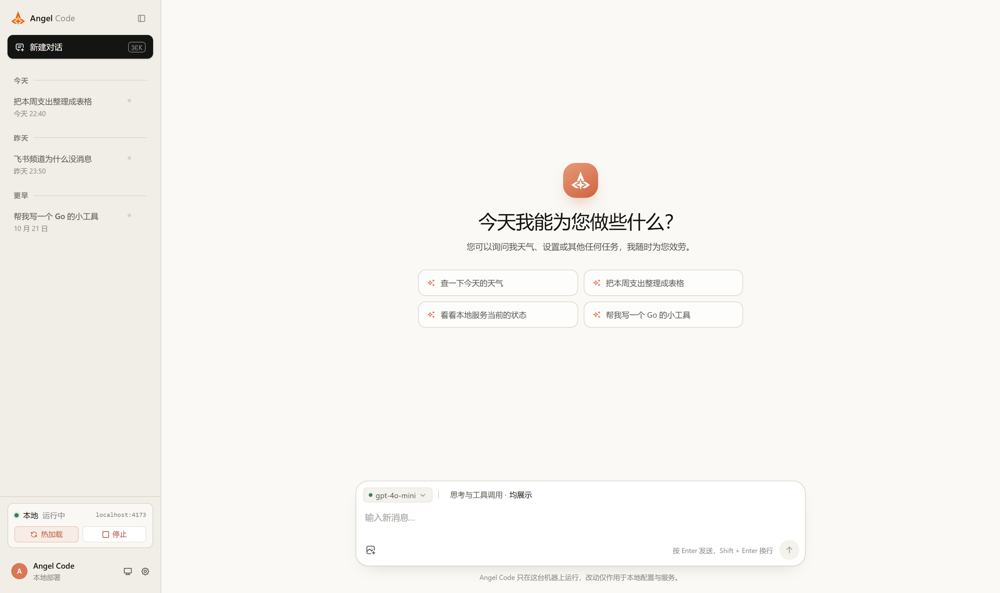
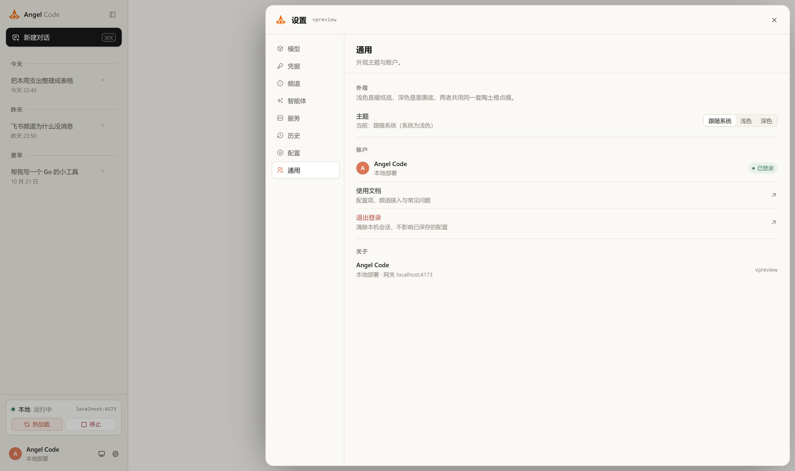
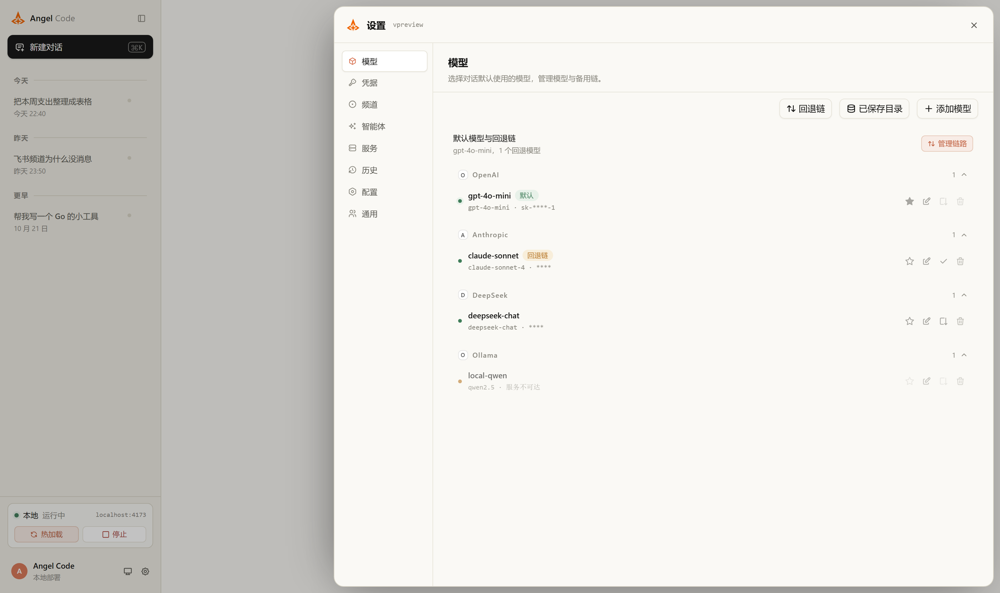
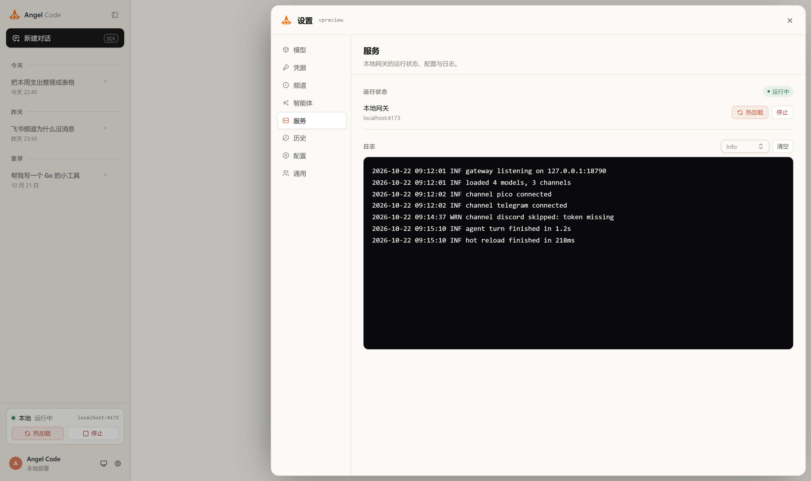
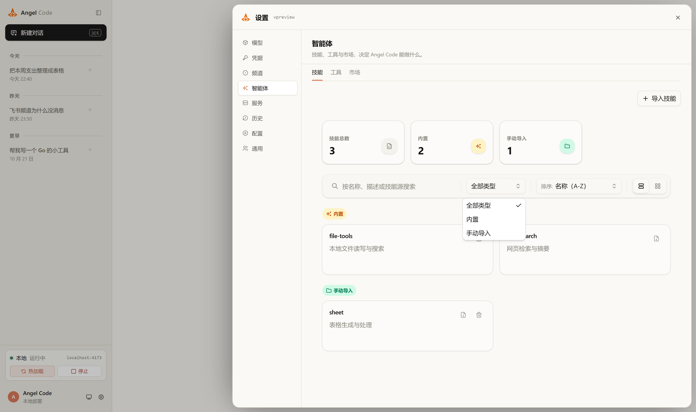

# AngelCode — 基于 PicoClaw 的品牌化衍生版本

> 上游项目：[sipeed/picoclaw](https://github.com/sipeed/picoclaw)（MIT）
> 本仓库定位：**在上游官方代码之上做品牌化与控制台界面改造的衍生分支**，保留上游全部能力，便于随时 rebase 跟进。

## 1. 分支模型

| 分支 | 内容 | 用途 |
|---|---|---|
| `main` | 与 `sipeed/picoclaw` 官方 `main` 完全一致 | 对照、取上游更新 |
| `angelcode` | 在官方 `main` 之上叠加本仓库的品牌化与界面改造 | 实际构建、部署 |

部署与构建请使用 `angelcode` 分支。同步上游：

```bash
git remote add upstream git@github.com:sipeed/picoclaw.git   # 已配置可省略
git fetch upstream
git checkout angelcode
git rebase upstream/main
```

## 2. 与上游的差异

### 2.1 品牌与外壳

- 品牌图形：`web/frontend/src/components/shell/angel-mark.tsx` 用 `` 引用 `src/assets/angelcode-logo.png`（1024 级 PNG，已修剪透明边），覆盖登录页、设置页抬头、侧栏、助手消息头像等全部品牌位；其余功能图标仍为 `lucide-react`，`favicon.svg` 与 PWA 图标未替换。
- 控制台外壳：`components/shell/` 下的 `angel-chat.tsx`、`angel-settings.tsx`、`angel-sidebar.tsx`、`angel-layout.tsx` 为本项目自绘的聊天/设置/侧栏布局（`ac-` 前缀样式类），样式集中在 `web/frontend/src/index.css`。

### 2.2 设置面板（浮层画中画）

- 设置面板由「贴右侧全高栏」改为**浮层卡片**：`position: fixed`，四周 10 px 留白，宽度 `clamp(680px, 66vw, 100vw - 20px)`（约 2/3 屏），圆角 16 px + 阴影，打开/关闭带位移动画；≤980 px 视口退回 6 px 留白、近全宽。
- 面板内所有设置页统一栅格：`.ac-row` 两列（标签左、控件右），最小行高 44 px，控件统一 26 px 高并右对齐；各分区内容左边距统一 24 px。

### 2.3 模型与「思考与工具」选择

- 模型 chip 直接显示**当前模型名**（原版显示 provider 名，切换后看不出变化）；切换默认模型改为乐观更新 + 失败回滚，不再回弹。
- 可选模型列表放宽：后端标记 `available=false` 的模型不再整体消失，而是列出并标注「未就绪」。
- 「思考与工具调用」菜单：均展示 / 仅思考 / 仅工具 / 隐藏 四档，补充了拖拽状态兜底（窗口失焦、拖拽中断时复位）。

### 2.4 弹层与下拉可用性

- `components/ui/select.tsx` 的 `SelectContent` 层级 z-50 → z-100；`dropdown-menu`、`popover` 同步 z-100，`tooltip` 提到 z-110，并在 `index.css` 追加兜底规则，保证设置面板（浮层）内的下拉、菜单、提示始终渲染在面板之上、可点击。
- 智能体页「全部类型 / 排序」筛选、工具库「全部状态」筛选：改为 popper 定位、触发器按内容自适应最小宽度、`whitespace-nowrap`，修复中文标签被箭头挤压、点了没反应的问题。
- 技能页视图切换按钮与筛选框统一到 36 px 行高；服务页「热加载 / 停止」按钮不再被 flex 拉伸挤压（`flex: 0 0 auto`、26 px、内容不换行）。

### 2.5 语言

- 默认**中文**：`src/i18n/index.ts` 不再依赖浏览器语言探测，语言持久化到 `localStorage["angelcode.lang"]`，并清理历史上的 `i18nextLng` 旧键；提供 `setAppLanguage` / `toggleAppLanguage`。
- `src/i18n/locales/zh.json` 补全模型/服务商等条目（如 `Provider` → 服务商）。

### 2.6 后端

- 统一 API 错误响应：新增 `web/backend/api/errors.go`（`writeAPIError`），`channels / config / models / skills / tools / session / oauth / gateway / wecom / weixin` 等接口的 `http.Error` 全部替换为结构化 JSON 错误。

### 2.7 预览与本地开发

- `web/frontend/src/preview/`（`preview-entry.tsx`、`mock-api.ts` 等）+ `vite.preview.config.ts` + `preview.html` + `PREVIEW.md`：一套离线 mock API 的单文件预览构建（`pnpm build:preview`），用于不启动后端时审查界面。

### 2.8 容器化与国内网络

- `docker/Dockerfile.wsl-launcher`：官方 `Dockerfile.launcher` 的国内网络适配版 —— 构建期 apk 走阿里云镜像（运行镜像内已还原为官方源）、`GOPROXY=goproxy.cn`、`GOTOOLCHAIN=local`、`go build -p=6`、pnpm 走 npmmirror；`HEALTHCHECK` 改探控制台 `18800/api/auth/status`（18790 为网关端口，未配置前不监听，官方 synology Dockerfile 亦如此）。
- `docker/synology/`：群晖/DSM 套件化打包（Dockerfile、entrypoint、compose、`build_image.py`、`build-kit.sh`、`IMAGES.md`）。
- `BUILD-FROM-SOURCE.md`：从源码构建（含 WSL 场景）的完整步骤。
- `.dockerignore` 追加 `web/frontend/node_modules`、`web/frontend/dist`、`web/preview-dist`，避免宿主机的 Windows 版依赖覆盖容器内 Linux 依赖。

## 3. 构建与部署

### 3.1 构建镜像（linux/amd64）

```bash
cd angelcode
docker buildx build --platform linux/amd64 --progress=plain \
  -f docker/Dockerfile.wsl-launcher \
  -t angel-code:latest --load .
docker save angel-code:latest -o angel-code.tar
```

### 3.2 在 NAS（群晖等）上运行

```bash
sudo docker load -i /volume1/docker/angel-code.tar
sudo docker run -d --name angel-code --restart unless-stopped \
  -p 18800:18800 -p 18790:18790 \
  -e TZ=Asia/Shanghai \
  -e PICOCLAW_GATEWAY_HOST=0.0.0.0 \
  -v /volume1/docker/angel-code/data:/data \
  angel-code:latest
```

浏览器访问 `http://<NAS-IP>:18800`，首次进入 `/launcher-setup` 设置控制台密码；`18790` 为网关端口，完成频道配置并「热加载」后监听。

## 4. 界面参考截图

截图取自前端离线预览构建（`pnpm build:preview`，mock API），分辨率 1600×950 @2x。

| 截图 | 说明 |
|---|---|
| `docs/screenshots/01-chat.png` | 聊天主界面：左上角品牌标识、助手消息头像、输入区与模型/思考工具 chip |
| `docs/screenshots/02-settings-general.png` | 设置面板（浮层画中画，约 2/3 屏宽）—「通用」 |
| `docs/screenshots/03-settings-models.png` | 设置 —「模型」：可用/未就绪模型与默认模型 |
| `docs/screenshots/04-settings-service.png` | 设置 —「服务」：热加载 / 停止 等操作按钮对齐 |
| `docs/screenshots/05-settings-agent-filters.png` | 设置 —「智能体」：全部类型 / 排序 下拉展开 |







## 5. 许可与致谢

本仓库遵循上游 MIT 许可（见 `LICENSE`），保留原始版权声明。核心能力（网关、频道、工具、智能体运行时等）来自 [sipeed/picoclaw](https://github.com/sipeed/picoclaw)，本仓库的贡献集中在品牌化、控制台界面、国内网络下的构建与 NAS 打包。
